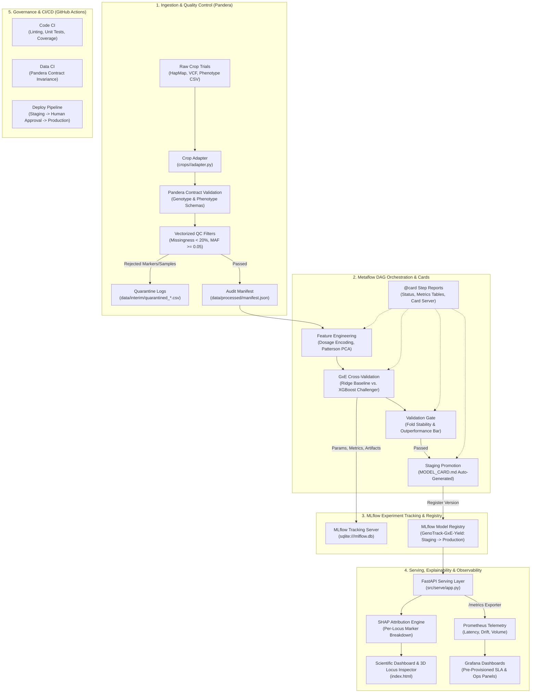

# GenoTrack — Reproducible MLOps Pipeline for Genomic Selection

[](https://www.python.org/downloads/release/python-3110/)
[](https://metaflow.org/)
[](https://mlflow.org/)
[](https://prometheus.io/)
[](https://grafana.com/)
[](https://fastapi.tiangolo.com/)
[](https://pandera.readthedocs.io/)
[](https://www.docker.com/)
[](https://github.com/features/actions)
[](https://opensource.org/licenses/MIT)

**GenoTrack** is a production-grade, crop-agnostic MLOps pipeline for **Genomic Selection (GS)** in digital agriculture and plant breeding. It predicts candidate crop phenotypic performance (grain yield, flowering time, plant height, maturity, lodging) directly from high-density genetic marker data (Single Nucleotide Polymorphisms / SNPs), providing full end-to-end lineage, strict auditability, automated model governance, and real-time observability from raw data ingestion to a served REST API and 3D scientific dashboard.

---

## 1. MLOps Toolchain Overview

GenoTrack implements a complete, enterprise-grade MLOps architecture:

| Tool | Responsibility in GenoTrack | Key Files & Artifacts |
|---|---|---|
| **Metaflow** | Directed Acyclic Graph (DAG) pipeline orchestration with rich, visual `@card` step reports | [`pipelines/flow.py`](file:///pipelines/flow.py), [`pipelines/compat.py`](file:///pipelines/compat.py) |
| **MLflow** | Experiment tracking, hyperparameter logging, run comparison history, and staged Model Registry (`Staging` $\rightarrow$ `Production`) | [`src/models/registry.py`](file:///src/models/registry.py), [`src/models/seed_mlflow.py`](file:///src/models/seed_mlflow.py), `mlflow.db` |
| **SHAP** | Per-locus genomic feature attribution mapped to chromosome/base-pair positions; powers the REST API and the 3D Locus Inspector | [`src/models/explain.py`](file:///src/models/explain.py), [`src/serve/app.py`](file:///src/serve/app.py) |
| **Prometheus** | Real-time telemetry scraper collecting prediction counts, p50/p95 latency, yield distributions, covariate drift, and active model versions | [`src/serve/app.py`](file:///src/serve/app.py) (`/metrics`), [`monitoring/prometheus/`](file:///monitoring/prometheus/) |
| **Grafana** | Pre-provisioned operational dashboard visualizing throughput, SLA percentiles, model drift, and environmental distributions | [`monitoring/grafana/dashboards/genotrack_ops.json`](file:///monitoring/grafana/dashboards/genotrack_ops.json) |
| **FastAPI** | High-throughput asynchronous REST serving layer with static dashboard hosting and OpenAPI specification | [`src/serve/app.py`](file:///src/serve/app.py), [`index.html`](file:///index.html) |
| **Docker Compose** | Multi-container stack orchestrating API (8000), Prometheus (9090), Grafana (3000), and MLflow (5000) | [`docker-compose.yml`](file:///docker-compose.yml), [`Dockerfile`](file:///Dockerfile) |
| **GitHub Actions** | Automated CI/CD (Code CI, Data CI, Continuous Training) and lightweight RBAC gating Production via Environment Protection Rules | [`.github/workflows/`](file:///.github/workflows/) |
| **Pandera & DVC** | Rigorous tabular schema contracts, missingness quarantine logging, and reproducible data pipeline stages | [`src/ingest/schemas.py`](file:///src/ingest/schemas.py), [`pipelines/dvc.yaml`](file:///pipelines/dvc.yaml) |

---

## 2. System Architecture



---

## 3. Repository Structure

```
GenoTrack/
├── README.md                           # Main repository documentation & MLOps guide
├── spec.md                             # Architectural specification & RFC contracts
├── requirements.txt                    # Project Python dependencies
├── Dockerfile                          # Production API container definition
├── docker-compose.yml                  # Full-stack orchestrator (API, MLflow, Prometheus, Grafana)
├── index.html                          # Precision scientific dashboard & 3D Genomic Locus Inspector
├── crops/
│   └── rice/                           # Reference implementation: Rice Diversity Panel
│       ├── config.yaml                 # Ploidy (2), QC thresholds, CV settings, GxE flags
│       ├── traits.yaml                 # Trait Registry (grain_yield, phenology, covariates)
│       ├── adapter.py                  # Vectorized HapMap and trial CSV adapter
│       └── README.md                   # Rice dataset provenance & trial description
├── data/
│   ├── raw/                            # Raw data directory (DVC tracked)
│   ├── interim/                        # Canonical & cleaned Parquet tables, quarantine CSVs
│   ├── processed/                      # Model dataset, dosage matrix, manifest.json, metadata
│   └── models/                         # Trained models, production aliases, Model Cards
├── pipelines/
│   ├── flow.py                         # Metaflow DAG with @card visual reports
│   ├── compat.py                       # Win32 compatibility layer (polling, atomic I/O, UTF-8)
│   ├── dvc.yaml                        # DVC pipeline stages
│   └── setup_data.py                   # Cross-platform raw data staging utility
├── src/
│   ├── ingest/                         # Pandera schemas and streaming ingestion
│   │   ├── schemas.py                  # GenotypeSchema and PhenotypeSchema
│   │   └── pipeline.py                 # Streaming ingestion runner
│   ├── clean/                          # Generic quality control filters
│   │   └── qc.py                       # Vectorized missingness, MAF, and batch diagnostics
│   ├── features/                       # Feature engineering & population genetics
│   │   ├── encoding.py                 # Ploidy-parameterized dosage calculation
│   │   ├── imputation.py               # Swappable missingness imputation
│   │   ├── split.py                    # Patterson-standardized PCA and balanced CV splits
│   │   └── pipeline.py                 # Feature matrix construction orchestrator
│   ├── models/                         # GxE models, training, validation, explainability
│   │   ├── gxe.py                      # GxERidgeModel and GxEXGBoostModel architectures
│   │   ├── baseline.py                 # Classical GBLUP-style comparator
│   │   ├── challenger.py               # Gradient boosted trees comparator
│   │   ├── train.py                    # Cross-validated training orchestrator + MLflow
│   │   ├── gate.py                     # Automated validation gate logic
│   │   ├── registry.py                 # Staged promotion & Markdown Model Card generator
│   │   ├── seed_mlflow.py              # Comparative historical runs & registry seeder
│   │   └── explain.py                  # SHAP attribution mapped to marker/chrom/pos
│   └── serve/                          # Model serving layer
│       └── app.py                      # FastAPI REST application + Prometheus /metrics
├── monitoring/
│   ├── prometheus/
│   │   └── prometheus.yml              # Prometheus scrape configuration (15s interval)
│   ├── grafana/
│   │   ├── provisioning/               # Automated data source & dashboard provisioning
│   │   │   ├── datasources/prometheus.yml
│   │   │   └── dashboards/dashboards.yml
│   │   └── dashboards/
│   │       └── genotrack_ops.json      # Production telemetry Grafana dashboard
│   └── seed_telemetry.py               # Live synthetic traffic & covariate drift simulator
├── .github/workflows/
│   ├── ci_code.yml                     # Code CI: Black, Flake8, Pytest test matrix
│   ├── ci_data.yml                     # Data CI: Pandera schema assertions on synthetic mutations
│   ├── continuous_training.yml         # Continuous Training triggered on data updates
│   └── deploy.yml                      # Staging deployment + RBAC Environment Protection Rule
└── tests/
    ├── fixtures/
    │   ├── synthetic_crop.py           # Multi-ploidy mock fixtures (ploidy=2 and ploidy=6)
    │   └── malformed_data.py           # Corrupted data fixtures for Data CI
    ├── test_adapter.py                 # Rice adapter & schema contract tests
    ├── test_features.py                # Dosage encoding, Patterson scaling & CV tests
    ├── test_gxe_models.py              # GxE fitting, predictions, & validation gate tests
    └── test_serve.py                   # FastAPI serving endpoints & Prometheus metrics tests
```

---

## 4. Quickstart Guide

### 4.1 Prerequisites
- Python 3.11+
- Git & Git LFS / DVC
- Docker & Docker Compose (for running the full telemetry stack)

### 4.2 Installation
```bash
git clone https://github.com/Helly121/GenoTrack.git
cd GenoTrack

# Create virtual environment
python -m venv venv
source venv/bin/activate       # On Linux/macOS
# .\venv\Scripts\activate      # On Windows

# Install dependencies
pip install -r requirements.txt
```

### 4.3 Staging Raw Data
Place your raw crop files into `datasets/Rice Diversity/` (or use the built-in setup script to stage into `data/raw/rice/`):
```bash
python pipelines/setup_data.py
```

### 4.4 Running Tests
Verify that all 16 unit and integration tests pass:
```bash
pytest tests/ -v
```

---

## 5. Pipeline Orchestration (Metaflow)

The entire GenoTrack pipeline is defined as a unified DAG in [`pipelines/flow.py`](file:///pipelines/flow.py) with `@card` decorators on every step for interactive visual inspection:

```
start ──> setup_data ──> ingest ──> clean ──> features ──> train ──> validation_gate ──> register ──> end
```

### Running the Metaflow DAG
```bash
python pipelines/flow.py run
```

*(Note: Windows users are natively supported via [`pipelines/compat.py`](file:///pipelines/compat.py), which transparently shims Win32 pipe polling and atomic file replacements).*

### Viewing Metaflow Cards
Metaflow generates self-contained HTML cards containing execution metadata, timing, and data tables:
```bash
# View card for a specific step in your default browser:
python -m pipelines.flow card view validation_gate

# Or launch the interactive Metaflow Card Server:
python -m pipelines.flow card server
```

---

## 6. Experiment Tracking & Model Registry (MLflow)

GenoTrack uses SQLite-backed MLflow for zero-maintenance, reproducible experiment tracking and model lifecycle governance.

### 6.1 Seeding Historical Comparison Runs
To seed the MLflow tracking store with comparative architectural runs (GBLUP Baseline, Naive Split Leakage, Challenger v1 LightGBM, Champion v2 XGBoost) and registered model versions:
```bash
python src/models/seed_mlflow.py
```

### 6.2 Launching the MLflow UI
```bash
mlflow ui --backend-store-uri sqlite:///mlflow.db --port 5000
```
Open [http://localhost:5000](http://localhost:5000) to inspect:
- **Experiments:** Run comparisons across Pearson $r$, RMSE, and fold variance.
- **Artifacts:** Saved model weights, confusion matrices, and parameter logs.
- **Model Registry:** Inspect `GenoTrack-GxE-Yield` staged in `Production` and `Archived`.

---

## 7. Model Serving & Prometheus Observability

GenoTrack's FastAPI serving layer serves real-time genomic predictions, exports Prometheus telemetry, and delivers the 3D locus dashboard.

### 7.1 Starting the API Server
```bash
uvicorn src.serve.app:app --host 0.0.0.0 --port 8000 --reload
```
- **Interactive OpenAPI Docs:** [http://localhost:8000/docs](http://localhost:8000/docs)
- **Scientific Dashboard & 3D Locus Inspector:** [http://localhost:8000/](http://localhost:8000/)
- **Prometheus Metrics:** [http://localhost:8000/metrics](http://localhost:8000/metrics)

### 7.2 Core Endpoints

#### Predict Panel Sample (`POST /predict/sample`)
Predicts performance for a known plant accession in a specific environment, decomposing genetic vs. environmental components with top SHAP markers:
```bash
curl -X POST http://localhost:8000/predict/sample \
  -H "Content-Type: application/json" \
  -d '{"sample_id": "A1256", "environment": "2011_DS"}'
```

#### Locus Attribution Breakdown (`GET /explain/locus/{marker_id}`)
Retrieves biological genomic coordinates, chromosome, position, and feature attribution for the 3D Locus Inspector:
```bash
curl -X GET http://localhost:8000/explain/locus/S1_11984
```

#### Prometheus Metrics Exporter (`GET /metrics`)
Exposes live telemetry for operational scraping:
- `genotrack_predictions_total`: Prediction counter partitioned by `crop`, `environment`, and `status`.
- `genotrack_inference_latency_seconds`: Latency histogram tracking p50, p95, and p99 SLA.
- `genotrack_predicted_yield_kg_ha`: Distribution histogram of predicted crop yields.
- `genotrack_covariate_missing_hill_ratio`: Covariate distribution for detecting field data drift.
- `genotrack_active_model_version`: Gauge reporting the active model version in production.

---

## 8. Monitoring & Telemetry (Prometheus & Grafana)

GenoTrack includes pre-provisioned Prometheus scrapers and a Grafana operational dashboard.

### 8.1 Simulating Production Telemetry Traffic
To seed realistic telemetry (normal multi-season queries, missing hill covariate drift, and canary calls):
```bash
python monitoring/seed_telemetry.py --endpoint http://localhost:8000/predict/sample --requests 100
```

### 8.2 Grafana Dashboard
Access Grafana at [http://localhost:3000](http://localhost:3000) (default credentials: `admin` / `admin`):
- **Prediction Throughput:** Real-time request rate (req/s) broken down by trial environment.
- **Inference Latency Percentiles:** p50, p95, and p99 response times against operational SLAs.
- **Predicted Yield Distribution:** Distribution monitoring to detect model output drift across harvest cycles.
- **Input Covariate Drift:** Missing hill ratios tracking field measurement quality.
- **Active Model Version:** Live gauge showing the current model artifact in production.

---

## 9. Full-Stack Containerization (Docker Compose)

Spin up the entire GenoTrack MLOps stack with a single command:

```bash
docker compose up -d
```

### Services Port Map
| Service | URL | Purpose |
|---|---|---|
| **API & Dashboard** | [http://localhost:8000](http://localhost:8000) | FastAPI serving layer & 3D Scientific Dashboard |
| **Prometheus** | [http://localhost:9090](http://localhost:9090) | Telemetry scraper & time-series database |
| **Grafana** | [http://localhost:3000](http://localhost:3000) | Pre-configured operational monitoring dashboards |
| **MLflow** | [http://localhost:5000](http://localhost:5000) | Experiment tracking & Model Registry UI |

To tear down the stack:
```bash
docker compose down
```

---

## 10. Governance & CI/CD (GitHub Actions)

GenoTrack enforces enterprise-grade quality gates and lightweight Role-Based Access Control (RBAC) via GitHub Actions:

1. **Code CI ([`ci_code.yml`](file:///.github/workflows/ci_code.yml)):**
   - Runs on every Pull Request to `master`.
   - Executes Flake8, Black, and pytest across the full unit/integration suite.
2. **Data CI ([`ci_data.yml`](file:///.github/workflows/ci_data.yml)):**
   - Validates data contract invariance using Pandera schemas.
   - Tests corrupted and mutated synthetic datasets to ensure quarantine isolation works properly without silent failures.
3. **Continuous Training ([`continuous_training.yml`](file:///.github/workflows/continuous_training.yml)):**
   - Triggers automated retrain and validation gate evaluation on dataset updates or schedule.
4. **Deploy & Governance ([`deploy.yml`](file:///.github/workflows/deploy.yml)):**
   - Deploys automatically to `staging`.
   - **Production Promotion Gate:** Uses GitHub Actions **Environment Protection Rules** requiring human review from designated lead agronomists / ML engineers before model promotion to production.

---

## 11. Reference Dataset (Rice Diversity Panel)

The reference implementation in `crops/rice/` is evaluated against real public agricultural research data:
- **Genotype (`MET_crfilt_.75_allchrom.hmp.txt`):** 108,025 Single Nucleotide Polymorphism (SNP) markers across 12 rice chromosomes for 368 biological accessions (batches A, B, and M), with plate controls (`BLANK`) and summary columns handled.
- **Phenotype (`RYT_plotdata_by_GHID_corrected_PUBLIC_ACCESS`):** 8 Replicated Yield Trials (RYT) over 4 consecutive years (2009–2012) across Dry Season (DS) and Wet Season (WS).
- **Target Traits:** Grain Yield (`Kg_ha`), Flowering Time (`FL`), Maturity (`MAT`), Plant Height (`PLTHGT`), Tillering (`TILLER`), Lodging Score (`LDG`).
- **Trial Covariates:** Missing Hill count (`Missing_Hill`) and Moisture Content (`MC`).

---

## 12. Extending to a New Crop

Adding a new crop (e.g. `maize` or hexaploid `wheat`) requires **zero modifications to `src/`**:

1. Create `crops/<crop_name>/`:
   ```bash
   mkdir -p crops/wheat
   ```
2. Define `crops/<crop_name>/config.yaml`:
   Set `crop_name`, `ploidy` (e.g. `6` for hexaploid wheat), QC thresholds, raw file paths, and G×E settings.
3. Define `crops/<crop_name>/traits.yaml`:
   Specify available traits, units, directions, and set `primary_target: true`.
4. Implement `crops/<crop_name>/adapter.py`:
   Implement `parse_genotype(raw_path) -> pd.DataFrame` and `parse_phenotype(raw_path) -> pd.DataFrame` conforming to canonical schemas.
5. Execute the pipeline:
   ```bash
   python pipelines/flow.py run --crop-name wheat
   ```

---

## 13. License

This project is licensed under the MIT License — see the [LICENSE](LICENSE) file for details.
