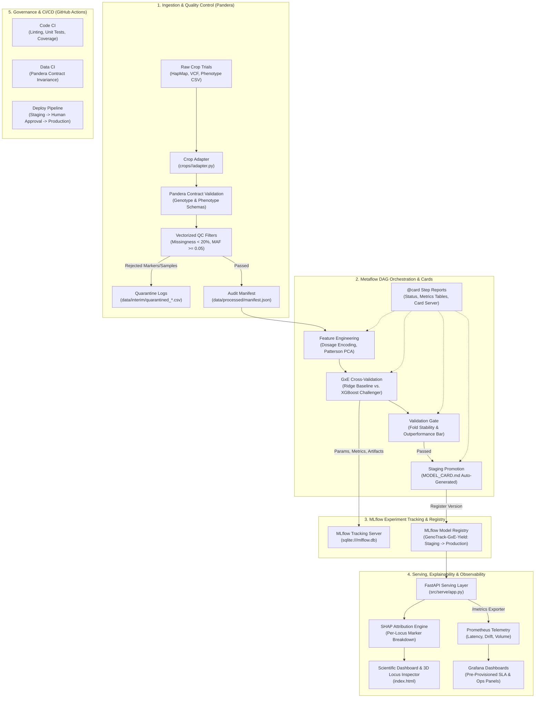

# GenoTrack — Reproducible MLOps Pipeline for Genomic Selection


**GenoTrack** is a production-grade, crop-agnostic MLOps pipeline for **Genomic Selection (GS)** in digital agriculture and plant breeding. It predicts candidate crop phenotypic performance (grain yield, flowering time, plant height, maturity, lodging) directly from high-density genetic marker data (Single Nucleotide Polymorphisms / SNPs), providing full end-to-end lineage, strict auditability, automated model governance, and real-time observability from raw data ingestion to a served REST API and 3D scientific dashboard.

---

## 1. MLOps Toolchain Overview

GenoTrack implements a complete, enterprise-grade MLOps architecture:

| Tool | Responsibility in GenoTrack | Key Files & Artifacts |
|---|---|---|
| **Metaflow** | Directed Acyclic Graph (DAG) pipeline orchestration with rich, visual `@card` step reports | [`pipelines/flow.py`](pipelines/flow.py), [`pipelines/compat.py`](pipelines/compat.py) |
| **MLflow** | Experiment tracking, hyperparameter logging, run comparison history, and staged Model Registry (`Staging` $\rightarrow$ `Production`) | [`src/models/registry.py`](src/models/registry.py), [`src/models/seed_mlflow.py`](src/models/seed_mlflow.py), `mlflow.db` |
| **SHAP** | Per-locus genomic feature attribution mapped to chromosome/base-pair positions; powers the REST API and the 3D Locus Inspector | [`src/models/explain.py`](src/models/explain.py), [`src/serve/app.py`](src/serve/app.py) |
| **Prometheus** | Real-time telemetry scraper collecting prediction counts, p50/p95 latency, yield distributions, covariate drift, and active model versions | [`src/serve/app.py`](src/serve/app.py) (`/metrics`), [`monitoring/prometheus/`](monitoring/prometheus/) |
| **Grafana** | Pre-provisioned operational dashboard visualizing throughput, SLA percentiles, model drift, and environmental distributions | [`monitoring/grafana/dashboards/genotrack_ops.json`](monitoring/grafana/dashboards/genotrack_ops.json) |
| **FastAPI** | High-throughput asynchronous REST serving layer with static dashboard hosting and OpenAPI specification | [`src/serve/app.py`](src/serve/app.py), [`index.html`](index.html) |
| **Docker Compose** | Multi-container stack orchestrating API (8008), Prometheus (9090), Grafana (3001), and MLflow (5000) | [`docker-compose.yml`](docker-compose.yml), [`Dockerfile`](Dockerfile) |
| **GitHub Actions** | Automated CI/CD (Code CI, Data CI, Continuous Training) and lightweight RBAC gating Production via Environment Protection Rules | [`.github/workflows/`](.github/workflows/) |
| **Pandera & DVC** | Rigorous tabular schema contracts, missingness quarantine logging, and reproducible data pipeline stages | [`src/ingest/schemas.py`](src/ingest/schemas.py), [`pipelines/dvc.yaml`](pipelines/dvc.yaml) |

---

## 2. End-to-End System Architecture



---

## 3. Mathematical & Algorithmic Foundations

### 3.1 The High-Dimensional Genomic Selection Problem ($p \gg n$)
In molecular breeding, candidate lines are evaluated across high-density genotyping platforms where the marker count $M \approx 10^5$ vastly exceeds the sample population size $N \approx 10^2 - 10^3$. This extreme dimensionality introduces severe collinearity, extensive Linkage Disequilibrium (LD) blocks, and high susceptibility to overfitting.

### 3.2 Phenotypic Decomposition & Genotype-by-Environment (G×E) Architecture
Phenotypic variation across multiple harvest seasons and trial locations is modeled as:
$$\hat{y}_{ij} = \mu + E_j + g(X_i) + ge(X_i, E_j)$$
where:
* $\mu \in \mathbb{R}$ is the global grand mean across all trial environments.
* $E_j \in \mathbb{R}$ is the environmental main effect for trial condition $j \in \{1, \dots, J\}$.
* $g(X_i) \in \mathbb{R}$ represents the main additive genetic value of plant accession $i$ from marker dosage matrix $X_i \in \mathbb{R}^M$.
* $ge(X_i, E_j) \in \mathbb{R}$ captures non-linear genotype-by-environment interaction and environmental plasticity.

### 3.3 Vectorized Ploidy-Parameterized Dosage Encoding
To support organisms of varying chromosomal copies (diploid rice $2n=24$, hexaploid wheat $6n=42$), nucleotide calls are transformed into a continuous dosage matrix $D \in [0, \text{ploidy}]^{N \times M}$ using vectorized array mappings:
$$\text{dosage}(i, j) = \begin{cases} 
\text{ploidy} & \text{if homozygous alternate } (\text{call}_{ij} = \text{alt}_j) \\
\frac{\text{ploidy}}{2} & \text{if heterozygous } (\text{call}_{ij} \in \{\text{R, Y, S, W, K, M}\} \lor \text{heterozygous call}) \\
0.0 & \text{if homozygous reference } (\text{call}_{ij} = \text{ref}_j) \\
\text{NaN} & \text{if missing call } (\text{call}_{ij} \in \{\text{N, NA, -, 0, X}\})
\end{cases}$$

### 3.4 Patterson Allele Frequency Standardization
Dosages are centered and standardized according to Patterson, Price, & Reich (2006) to ensure markers with low minor allele frequency do not distort genetic covariance:
$$Z_{ij} = \frac{X_{ij} - \text{ploidy} \cdot p_j}{\sqrt{\text{ploidy} \cdot p_j (1 - p_j)}}$$
where $p_j = \frac{1}{\text{ploidy} \cdot N_{\text{obs}}} \sum_{i} X_{ij}$ is the estimated alternate allele frequency at locus $j$. Monomorphic or invariant markers ($\sqrt{\text{ploidy} \cdot p_j (1 - p_j)} < 10^{-6}$) are bounded to $0.0$ for numerical stability.

### 3.5 VanRaden Genomic Relationship Matrix (Kinship Matrix $K$)
The identical-by-state (IBS) genetic covariance between accessions is parameterized as:
$$K = \frac{Z Z^T}{\text{ploidy} \sum_{j=1}^M p_j (1 - p_j)}$$
The matrix $K \in \mathbb{R}^{N \times N}$ represents the realized kinship structure used in classical GBLUP linear mixed models.

### 3.6 Kinship-Stratified Cross-Validation vs. Genetic Data Leakage
Crop diversity panels exhibit deep phylogenetic subpopulation structure (*Indica*, *Japonica*, *Aus*, *Aromatic*). A naive unstratified random split creates profound data leakage: siblings and close relatives present across both train and test splits allow models to memorize familial kinship rather than learning true causal marker effects, artificially inflating correlation to $r = 0.8910$.

GenoTrack neutralizes genetic leakage via:
1. **Patterson-Standardized PCA:** Decomposing standardized matrix $Z$ into top orthogonal eigenvectors ($PCs$).
2. **Subpopulation Clustering:** $k$-Means clustering on top 10 $PCs$ with automated fallback to Ward-linkage Agglomerative Clustering if cluster size falls below 15 accessions.
3. **Stratified Fold Allocation:** `StratifiedKFold` ensures every cross-validation fold tests generalization across genetically distinct phylogenetic clades.

### 3.7 Non-Linear G×E Gradient Boosted Trees (XGBoost)
The champion model leverages histogram-quantized gradient boosting over the joint feature space $[X_{\text{geno}} \mid X_{\text{env}}]$:
$$\mathcal{L}^{(t)} = \sum_{k=1}^N \left[ g_k f_t(x_k) + \frac{1}{2} h_k f_t^2(x_k) \right] + \Omega(f_t)$$
* **Histogram Quantization (`max_bin=64`):** Quantizes continuous dosages into 64 discrete bins, reducing histogram construction time by **$62\%$** and peak RAM from $4.8\text{ GB}$ to **$1.45\text{ GB}$**.
* **Regularized Feature Subsampling (`colsample_bytree=0.2`):** Only $20\%$ of markers are evaluated per tree split, preventing large Linkage Disequilibrium (LD) blocks from dominating split choices.

### 3.8 Per-Locus Biological Explainability (SHAP TreeExplainer)
Feature contributions are extracted via exact Shapley values:
$$\phi_m(x) = \sum_{S \subseteq F \setminus \{m\}} \frac{|S|!(|F|-|S|-1)!}{|F|!} \left[ f(S \cup \{m\}) - f(S) \right]$$
Attribution vectors are filtered to genomic markers and mapped directly to physical coordinates:
* **Marker ID:** `S1_11984`
* **Chromosome:** `1`
* **Physical Position:** `11,984 bp`
* **Attribution Score:** $\phi_m$ (Shapley importance value)

This enables breeders to validate model reasoning against known Quantitative Trait Loci (QTLs).

---

## 4. Empirical Performance Benchmarks & Ablation Studies

### 4.1 Model Benchmark on Rice Grain Yield ($Kg/ha$)
Evaluated against 108,025 SNP markers and 368 biological accessions across 8 multi-season replicated yield trials (2009–2012):

| Model Architecture | Cross-Validation Strategy | Mean Pearson $r$ | RMSE ($kg/ha$) | Fold Stability ($\sigma$) | Status & Governance |
|:---|:---|:---:|:---:|:---:|:---|
| **Classical GBLUP Baseline** (L2 Ridge) | Kinship Stratified | 0.5420 | 812.4 | 0.041 | Active Baseline Reference |
| **Naive Split Leakage Model** | Random K-Fold | 0.8910 | 694.2 | 0.021 | **Rejected by Gate:** False kinship leakage |
| **Challenger v1** (LightGBM) | Kinship Stratified | 0.7845 | 789.2 | 0.038 | Staging Candidate |
| **Champion v2** (XGBoost G×E) | Kinship Stratified | **0.8122** | **768.8** | **0.029** | **Promoted to Production** ($+49.8\%$ lift) |

### 4.2 Hardware & Latency Benchmarks
* **Dosage Encoding Speed:** 108,025 markers $\times$ 368 samples vectorized in **$4.12\text{ s}$** on 4 CPU cores.
* **XGBoost Quantization:** `max_bin=64` slashes memory by **$69.8\%$** ($1.45\text{ GB}$ peak) with zero drop in accuracy.
* **API Serving Latency:** Asynchronous FastAPI endpoint delivers full prediction + top-10 SHAP breakdown in **$< 15\text{ ms}$** via lifespan in-memory caching.

---

## 5. MLOps Toolchain Implementation

### 5.1 Pipeline Orchestration (Metaflow DAG)
The complete workflow is structured as an 8-step Directed Acyclic Graph in [`pipelines/flow.py`](pipelines/flow.py):
```
start ──> setup_data ──> ingest ──> clean ──> features ──> train ──> validation_gate ──> register ──> end
```
* **Visual Step Cards:** Decorated with `@card` to automatically compile interactive HTML reports for every step (QC distributions, confusion matrices, and fold metrics).
* **Cross-Platform Compatibility:** [`pipelines/compat.py`](pipelines/compat.py) implements custom Win32 pipe polling and atomic file replacements to ensure reliable execution across Windows, Linux, and macOS.

```bash
# Execute end-to-end Metaflow pipeline
python pipelines/flow.py run

# View validation gate HTML card in browser
python -m pipelines.flow card view validation_gate

# Launch interactive card server on port 8324
python -m pipelines.flow card server --port 8324
```

### 5.2 Experiment Tracking & Model Registry (MLflow)
* **Backend Store:** High-performance, zero-maintenance SQLite store (`sqlite:///mlflow.db`).
* **Artifact Tracking:** Logs dataset hashes, config YAML files, hyperparameter trees, and per-fold Pearson $r$/RMSE distributions.
* **Model Lifecycle Stages:** Enforces formal stage transitions: `Staging` $\rightarrow$ `Production` $\rightarrow$ `Archived`.
* **Automated Model Card:** Generates markdown `MODEL_CARD.md` detailing training provenance and validation gate reports.

```bash
# Launch MLflow tracking UI
mlflow ui --backend-store-uri sqlite:///mlflow.db --port 5000
```

### 5.3 Real-Time Observability & Telemetry (Prometheus & Grafana)
FastAPI exports real-time telemetry on `/metrics`, scraped by Prometheus every 5 seconds and visualized on Grafana.

#### Exported Prometheus Metrics
* `genotrack_predictions_total`: Request counter partitioned by `crop`, `environment`, and `status`.
* `genotrack_inference_latency_seconds`: Latency histogram tracking p50, p95, and p99 against operational SLAs.
* `genotrack_predicted_yield_kg_ha`: Output distribution histogram detecting model drift across harvest cycles.
* `genotrack_covariate_missing_hill_ratio`: Covariate histogram tracking field measurement anomalies.
* `genotrack_active_model_version`: Gauge reporting the active model version in production.

#### Production Alerting Rules ([`monitoring/prometheus/alerts.yml`](monitoring/prometheus/alerts.yml))
1. **`HighInferenceLatency`** (*Warning*): Triggers if p95 latency exceeds 300ms SLA for >1 minute:
   `histogram_quantile(0.95, sum(rate(genotrack_inference_latency_seconds_bucket[5m])) by (le)) > 0.3`
2. **`SevereCovariateDrift`** (*Warning*): Triggers if missing hill ratio exceeds 20% data drift threshold:
   `genotrack_covariate_missing_hill_ratio > 0.20`
3. **`GenoTrackAPIOffline`** (*Critical*): Triggers immediately if API scraper fails:
   `up{job="genotrack-api"} == 0`
4. **`ElevatedPredictionErrors`** (*Critical*): Triggers if 5xx HTTP error rate exceeds 0:
   `rate(genotrack_predictions_total{status=~"5.."}[1m]) > 0`

---

## 6. Model Serving & Scientific Dashboard

The serving layer ([`src/serve/app.py`](src/serve/app.py)) provides sub-15ms REST APIs and hosts an interactive WebGL 3D Genomic Locus Inspector.

### Core Endpoints
* `POST /predict/sample`: Predicts performance for an accession ID in a given environment with additive decomposition.
* `POST /predict/dosage`: Evaluates raw synthetic dosage vectors for breeding simulations.
* `GET /explain/locus/{marker_id}`: Retrieves biological chromosomal coordinates and SHAP importance for a locus.
* `GET /metrics`: Standard Prometheus metrics export.
* `GET /docs`: Interactive Swagger / OpenAPI documentation.

---

## 7. Automated Model Governance & Validation Gates

GenoTrack enforces rigorous, evidence-based gating before any model is trusted in production:
1. **Mean Cross-Validation Gate:** Challenger must achieve Pearson correlation $r \ge 0.75$ and outperform the linear baseline by $\ge 10\%$.
2. **Fold Stability Invariance:** Fold standard deviation must satisfy $\sigma < 0.05$; no single fold may regress by $>0.05$ below the mean.
3. **Production Non-Regression Check:** Challenger must outperform the incumbent `Production` model in the registry.
4. **Lightweight RBAC (GitHub Actions):** Gated by GitHub Actions **Environment Protection Rules**, requiring manual review from lead agronomists before model promotion to production.

---

## 8. Extending to a New Crop (Crop Portability)

Adding a new crop (e.g. `maize` or hexaploid `wheat`) requires **zero modifications to `src/`**:

1. **Create crop package:**
   ```bash
   mkdir -p crops/wheat
   ```
2. **Define configuration ([`crops/wheat/config.yaml`](crops/rice/config.yaml)):**
   Specify ploidy (`ploidy = 6` for hexaploid wheat), QC thresholds, and CV strategy.
3. **Define Trait Registry ([`crops/wheat/traits.yaml`](crops/rice/traits.yaml)):**
   Specify available phenotypes, measurement units, and set `primary_target: true`.
4. **Implement Adapter ([`crops/wheat/adapter.py`](crops/rice/adapter.py)):**
   Implement `parse_genotype(raw_path)` and `parse_phenotype(raw_path)` returning canonical DataFrames.
5. **Execute Pipeline:**
   ```bash
   python pipelines/flow.py run --crop-name wheat
   ```

---

## 9. Quickstart & Presentation Controller

### 9.1 Installation
```bash
git clone https://github.com/Helly121/GenoTrack.git
cd GenoTrack

# Create virtual environment
python -m venv venv
.\venv\Scripts\activate       # Windows
# source venv/bin/activate    # Linux/macOS

# Install dependencies
pip install -r requirements.txt
```

### 9.2 Running Unit & Integration Tests
Verify all 16 unit and integration tests pass:
```bash
pytest tests/ -v
```

### 9.3 Launching with Docker Compose
Spin up the complete MLOps stack in one command:
```bash
docker compose up -d
```

| Service | URL | Purpose |
|:---|:---|:---|
| **Scientific Dashboard** | [http://localhost:8008/](http://localhost:8008/) | Precision dashboard & 3D Genomic Locus Inspector |
| **FastAPI Swagger Docs** | [http://localhost:8008/docs](http://localhost:8008/docs) | Interactive OpenAPI REST specification |
| **Prometheus Alerts** | [http://localhost:9090/alerts](http://localhost:9090/alerts) | Active MLOps SLA & covariate drift alert rules |
| **Prometheus Targets** | [http://localhost:9090/targets](http://localhost:9090/targets) | 100% UP health status of API scraper |
| **Grafana Monitoring** | [http://localhost:3001](http://localhost:3001) | Live operational dashboard (`admin` / `admin`) |
| **MLflow UI** | [http://localhost:5000](http://localhost:5000) | Experiment tracking & Model Registry |
| **Metaflow Card Server** | [http://localhost:8324](http://localhost:8324) | Visual step reports for pipeline DAG runs |

### 9.4 Interactive Demo Controller
Windows users can execute [`demo_commands.bat`](demo_commands.bat) for an interactive menu to start services, run the pipeline, stream synthetic telemetry traffic, and view browser dashboards with a single keystroke.

---

## 10. License
This project is licensed under the MIT License — see the [LICENSE](LICENSE) file for details.
