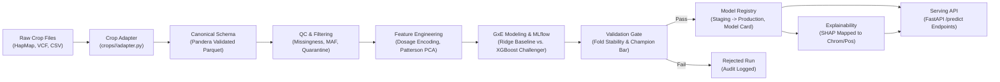

# GenoTrack — Reproducible MLOps Pipeline for Genomic Selection

[](https://www.python.org/downloads/release/python-3110/)
[](https://mlflow.org/)
[](https://dvc.org/)
[](https://fastapi.tiangolo.com/)
[](https://pandera.readthedocs.io/)
[](https://www.docker.com/)
[](https://opensource.org/licenses/MIT)

**GenoTrack** is a production-grade, crop-agnostic MLOps pipeline for **Genomic Selection (GS)** in digital agriculture and plant breeding. It predicts a candidate crop's phenotypic performance (grain yield, flowering time, plant height, maturity, lodging) directly from high-density genetic marker data (Single Nucleotide Polymorphisms / SNPs), providing full end-to-end lineage, strict auditability, and automated model governance from raw data ingestion to a served REST API.

---

## 1. Core Engineering Principles

1. **Crop-Agnostic Core:** The pipeline code in `src/` makes zero assumptions about crop species, ploidy, raw file formats, or trait names. Plugging in a new crop (e.g. diploid rice, maize, or hexaploid wheat) requires writing **one isolated crop adapter and one config file** in `crops/<crop_name>/` — zero changes to the core engine.
2. **Canonical Schema Contract:** Every pipeline stage operates on standardized long-format schemas (`Genotype` and `Phenotype`), rigorously enforced via Pandera schema contracts.
3. **Mandatory G×E Awareness:** Crop performance is deeply driven by Genotype-by-Environment (G×E) interactions. The modeling architecture explicitly decomposes traits into population means, environmental main effects ($E_j$), additive genetic effects ($g(X_i)$), and environmental reaction norms / interaction effects ($ge(X_i, E_j)$).
4. **Scale Discipline:** High-density panels (e.g. 100K+ markers across hundreds of accessions, yielding ~40M calls) are processed strictly using vectorized 2D NumPy array broadcasting and streaming Apache Parquet I/O — zero row-wise Python loops (`.iterrows()` and `.apply(axis=1)` are prohibited).
5. **No Silent Drops & Full Auditability:** Any sample or marker rejected due to missingness, Minor Allele Frequency (MAF), or format corruption is logged to an explicit quarantine artifact (`quarantined_*.csv`) and registered in `data/processed/manifest.json`.
6. **Evidence-Based Validation Gate:** No model reaches production without passing an automated multi-criteria gate comparing challenger performance against a classical genomic baseline (GBLUP Ridge) and checking cross-validation stability.

---

## 2. System Architecture



| Layer | Responsibility | Crop-Specific? |
|---|---|---|
| **Crop Adapter** | Parse raw formats into canonical schemas (`crops/<crop>/adapter.py`) | **Yes (isolated)** |
| **Ingestion & Schema QC** | Pandera data contract validation, corruption quarantining (`src/ingest/`) | No |
| **Quality Control** | Vectorized missingness filter, MAF filter, batch confounding audit (`src/clean/`) | No |
| **Feature Engineering** | Ploidy dosage encoding ($0..\text{ploidy}$), swappable imputation, Patterson PCA (`src/features/`) | No |
| **G×E Modeling** | Multi-environment G×E Ridge comparator and XGBoost challenger with MLflow tracking (`src/models/`) | No |
| **Validation Gate** | Cross-validation stability and baseline outperformance verification (`src/models/gate.py`) | No |
| **Registry & Serving** | Automated `MODEL_CARD.md`, biological SHAP mapping, FastAPI serving (`src/serve/`) | No |
| **3D Interactive Hero** | Scroll-driven WebGL visualization of genotype markers and expressed traits (`index.html`) | UI Layer |

---

## 3. Repository Structure

```
GenoTrack/
├── README.md                           # Main repository documentation
├── spec.md                             # Architectural specification & RFC contracts
├── requirements.txt                    # Project Python dependencies
├── Dockerfile                          # Production serving container definition
├── index.html                          # "Helix and Harvest" scroll-driven 3D WebGL experience
├── crops/
│   └── rice/                           # Reference implementation: Rice Diversity Panel
│       ├── config.yaml                 # Ploidy (2), QC thresholds, CV settings, GxE flags
│       ├── traits.yaml                 # Trait Registry (grain_yield primary, phenology, covariates)
│       ├── adapter.py                  # Vectorized HapMap and trial CSV adapter
│       └── README.md                   # Rice dataset provenance & trial description
├── data/
│   ├── raw/                            # Raw data directory (DVC tracked)
│   ├── interim/                        # Canonical & cleaned Parquet tables, quarantine CSVs
│   ├── processed/                      # Model dataset, dosage matrix, manifest.json, metadata
│   └── models/                         # Trained models, production aliases, Model Cards
├── src/
│   ├── ingest/                         # Pandera schemas and ingestion pipeline
│   │   ├── schemas.py                  # GenotypeSchema and PhenotypeSchema
│   │   └── pipeline.py                 # Streaming ingestion runner
│   ├── clean/                          # Generic quality control filters
│   │   └── qc.py                       # Vectorized missingness, MAF, and batch diagnostics
│   ├── features/                       # Feature engineering & population genetics
│   │   ├── encoding.py                 # Ploidy-parameterized dosage calculation
│   │   ├── imputation.py               # Swappable missingness imputation
│   │   ├── split.py                    # Patterson-standardized PCA and balanced CV splits
│   │   └── pipeline.py                 # Feature matrix construction orchestrator
│   ├── models/                         # GxE models, training, validation, explainability
│   │   ├── gxe.py                      # GxERidgeModel and GxEXGBoostModel architectures
│   │   ├── baseline.py                 # Classical GBLUP-style comparator
│   │   ├── challenger.py               # Gradient boosted trees comparator
│   │   ├── train.py                    # Cross-validated training orchestrator + MLflow
│   │   ├── gate.py                     # Automated validation gate logic
│   │   ├── registry.py                 # Staged promotion & Markdown Model Card generator
│   │   └── explain.py                  # SHAP attribution mapped to marker/chrom/pos
│   └── serve/                          # Model serving layer
│       └── app.py                      # FastAPI REST application
├── pipelines/
│   ├── dvc.yaml                        # DVC reproducible pipeline stages
│   └── setup_data.py                   # Cross-platform raw data staging utility
└── tests/
    ├── fixtures/
    │   ├── synthetic_crop.py           # Multi-ploidy mock fixtures (ploidy=2 and ploidy=6)
    │   └── malformed_data.py           # Corrupted data fixtures for Data CI
    ├── test_adapter.py                 # Rice adapter & schema contract tests
    ├── test_features.py                # Dosage encoding, Patterson scaling & CV tests
    ├── test_gxe_models.py              # GxE fitting, predictions, & validation gate tests
    └── test_serve.py                   # FastAPI serving endpoints test suite
```

---

## 4. Quickstart Guide

### 4.1 Prerequisites
- Python 3.11+
- Git & Git LFS / DVC
- Docker (optional, for containerized serving)

### 4.2 Installation
```bash
git clone https://github.com/Helly121/GenoTrack.git
cd GenoTrack

# Create virtual environment
python -m venv venv
source venv/bin/activate       # On Linux/macOS
# .\venv\Scripts\activate      # On Windows

# Install dependencies
pip install -r requirements.txt
```

### 4.3 Staging Raw Data
Place your raw crop files into `datasets/Rice Diversity/` (or use the built-in setup script to stage into `data/raw/rice/`):
```bash
python pipelines/setup_data.py
```

### 4.4 Running Tests
Run the comprehensive test suite (including ploidy generalization, Patterson PCA scaling, schema rejection tests, and serving API tests):
```bash
pytest tests/ -v
```

---

## 5. End-to-End Pipeline Execution

You can run each stage independently or orchestrate via DVC:

### Step 1: Ingestion & Schema Validation
Parses raw HapMap and trial CSVs into canonical, Pandera-validated Parquet tables:
```bash
python -m src.ingest.pipeline
```
*Output: `data/interim/canonical_genotype.parquet`, `data/interim/canonical_phenotype.parquet`*

### Step 2: Quality Control & Quarantine Audit
Applies vectorized missingness (< 20%) and MAF (≥ 0.05) filters, audits batch effects, and emits quarantine logs:
```bash
python -m src.clean.qc
```
*Output: `data/processed/manifest.json`, `data/interim/quarantined_*.csv`*

### Step 3: Feature Engineering & Patterson PCA
Performs ploidy-parameterized dosage encoding, swappable imputation, and Patterson-standardized PCA subpopulation clustering:
```bash
python -c "from src.features.pipeline import run_features; run_features('rice')"
```
*Output: `data/processed/dosage_matrix.parquet`, `data/processed/model_dataset_grain_yield.parquet`*

### Step 4: Model Training & MLflow Experiment Tracking
Fits multi-environment G×E Ridge baseline and G×E XGBoost challenger across population-structure-aware folds:
```bash
python -c "from src.models.train import train_and_track; train_and_track('rice', 'grain_yield')"
```
*Output: MLflow experiment logs, `data/models/*.joblib`, `data/processed/training_results_grain_yield.json`*

### Step 5: Validation Gate & Model Promotion
Verifies that the challenger passes the evidence bar and promotes to Production with an auto-generated Model Card:
```bash
python -c "
from src.models.gate import evaluate_validation_gate
from src.models.registry import promote_and_generate_model_card

gate_report = evaluate_validation_gate('data/processed/training_results_grain_yield.json', 'rice')
if gate_report['status'] == 'PASSED':
    promote_and_generate_model_card('data/processed/training_results_grain_yield.json', gate_report)
"
```
*Output: `data/models/production_rice_grain_yield.joblib`, `data/models/MODEL_CARD_rice_grain_yield.md`*

---

## 6. Model Serving & API Reference

Start the production serving API with Uvicorn:
```bash
uvicorn src.serve.app:app --host 0.0.0.0 --port 8000 --reload
```

Interactive OpenAPI documentation is available at `http://localhost:8000/docs`.

### API Endpoints

#### 1. Healthcheck (`GET /health`)
Returns service status, loaded model artifact, and registry lineage tags.
```bash
curl -X GET http://localhost:8000/health
```

#### 2. Environment Catalog (`GET /environments`)
Lists all supported trial environments and broad-sense average mode.
```bash
curl -X GET http://localhost:8000/environments
```
**Response:**
```json
{
  "crop": "rice",
  "target_trait": "grain_yield",
  "supported_environments": [
    "across_environments",
    "2009_DS",
    "2009_WS",
    "2010_DS",
    "2010_WS",
    "2011_DS",
    "2011_WS",
    "2012_DS",
    "2012_WS"
  ],
  "total_trial_environments": 8
}
```

#### 3. Predict Panel Sample (`POST /predict/sample`)
Predicts performance for a known plant accession in a specific environment, with genetic vs. environmental decomposition and top SHAP genomic markers:
```bash
curl -X POST http://localhost:8000/predict/sample \
  -H "Content-Type: application/json" \
  -d '{
    "sample_id": "A1256",
    "environment": "2011_DS"
  }'
```
**Response:**
```json
{
  "sample_id": "A1256",
  "environment": "2011_DS",
  "target_trait": "grain_yield",
  "predicted_value": 6842.50,
  "unit": "kg_per_ha",
  "genetic_component": 6210.00,
  "environmental_effect": 632.50,
  "top_contributing_markers": [
    {
      "marker_id": "S1_11984",
      "chrom": "1",
      "pos": 11984,
      "shap_value": 42.15,
      "dosage": 0.0
    }
  ]
}
```

#### 4. Predict Custom Genotype Vector (`POST /predict/dosage`)
Predicts performance for custom candidate SNP dosages ($0..\text{ploidy}$):
```bash
curl -X POST http://localhost:8000/predict/dosage \
  -H "Content-Type: application/json" \
  -d '{
    "dosage_vector": [0.0, 1.0, 2.0, ...],
    "environment": "across_environments"
  }'
```

---

## 7. Containerization (Docker)

Build and run the self-contained production serving container:
```bash
# Build Docker image
docker build -t genotrack:latest .

# Run container
docker run -p 8000:8000 genotrack:latest
```

---

## 8. Reference Dataset (Rice Diversity Panel)

The reference implementation in `crops/rice/` is tested against real public agricultural research data:
- **Genotype (`MET_crfilt_.75_allchrom.hmp.txt`):** 108,025 Single Nucleotide Polymorphism (SNP) markers across 12 rice chromosomes for 368 biological accessions (batches A, B, and M), with plate controls (`BLANK`) and summary columns (`call_rate`) handled.
- **Phenotype (`RYT_plotdata_by_GHID_corrected_PUBLIC_ACCESS`):** 8 Replicated Yield Trials (RYT) over 4 consecutive years (2009–2012) across Dry Season (DS) and Wet Season (WS).
- **Target Traits:** Grain Yield (`Kg_ha`), Flowering Time (`FL`), Maturity (`MAT`), Plant Height (`PLTHGT`), Tillering (`TILLER`), Lodging Score (`LDG`).
- **Trial Covariates:** Missing Hill count (`Missing_Hill`) and Moisture Content (`MC`).

---

## 9. Extending to a New Crop

Adding a new crop (e.g. `maize` or `wheat`) requires **zero modifications to `src/`**:

1. Create `crops/<crop_name>/`:
   ```bash
   mkdir -p crops/wheat
   ```
2. Define `crops/<crop_name>/config.yaml`:
   Set `crop_name`, `ploidy` (e.g. `6` for hexaploid wheat), QC thresholds, raw file paths, and G×E settings.
3. Define `crops/<crop_name>/traits.yaml`:
   Specify available traits, units, directions, and set `primary_target: true`.
4. Implement `crops/<crop_name>/adapter.py`:
   Implement `parse_genotype(raw_path) -> pd.DataFrame` and `parse_phenotype(raw_path) -> pd.DataFrame` conforming to the Section 5 canonical schemas.
5. Execute the pipeline:
   ```bash
   python -m src.ingest.pipeline --crop wheat
   ```

---

## 10. License

This project is licensed under the MIT License — see the [LICENSE](LICENSE) file for details.
