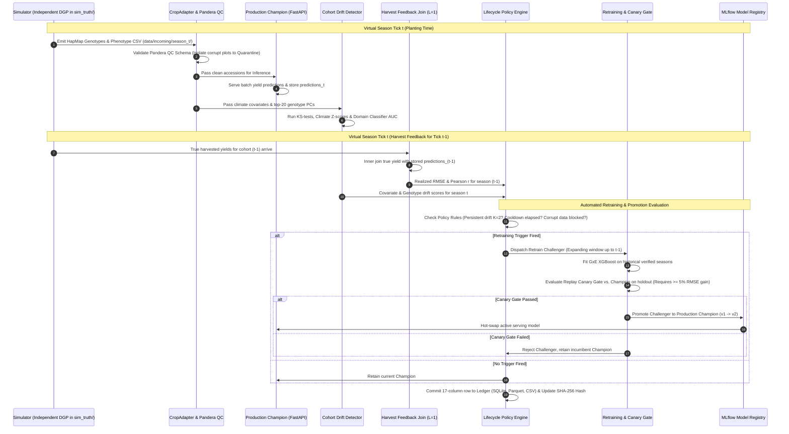
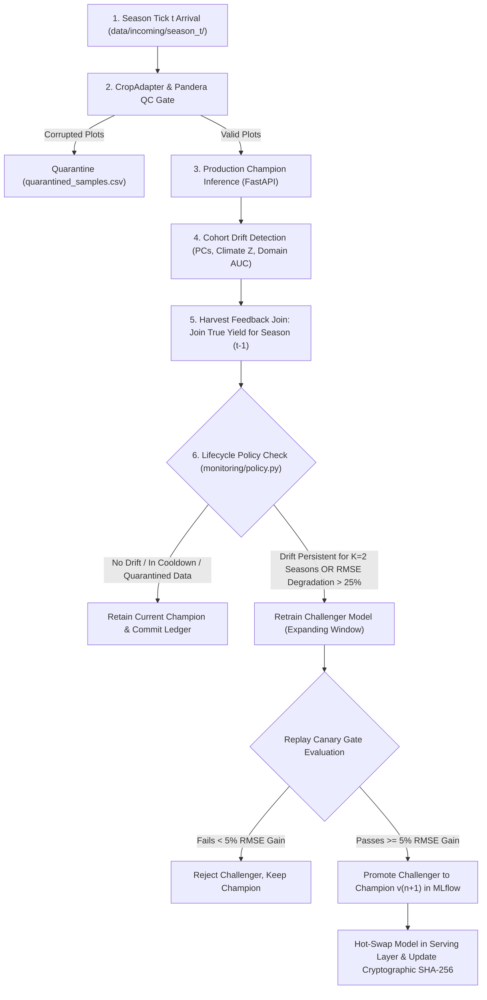

# GenoTrack: Closed-Loop Retraining & Continuous Simulation Pipeline

**System Component:** Virtual Breeding Program & Autonomous Retraining Cycle  
**Orchestrator Path:** `simulation/run_lifecycle.py`  
**Monitoring Engine:** `monitoring/drift_detector.py`  
**Decision Policy:** `monitoring/policy.py`  
**Thresholds Config:** `monitoring/thresholds.yaml`  
**Ledger Storage:** `data/simulation/ledger.db`, `data/simulation/ledger.parquet`, `docs/lifecycle/ledger.csv`  

---

## 1. Executive Summary & Purpose

In classical machine learning benchmarks, models are evaluated on static, pre-collected datasets. In real-world digital agriculture and plant breeding, however, deployed genomic prediction models encounter an operational reality characterized by **delayed ground truth, directional genetic drift, and volatile climatic shocks**:

1. **Delayed Ground Truth (Label Lag $L=1$ Season):**  
   At planting time (tick $t$), juvenile seedling DNA (SNP marker profiles) and target seasonal weather forecasts arrive. The model must immediately predict mature harvest yield to guide field selection and agronomic management. The actual ground truth yield data is not physically harvested until **4 to 6 months later** (tick $t+1$).
2. **Directional Genetic Drift:**  
   Plant breeding is artificial selection. By advancing only high-yielding progeny, breeders systematically increase favorable allele frequencies ($p_j \to 1.0$) and deplete genetic variance across successive breeding cycles, shifting the genetic distribution away from the original training set.
3. **Climatic Volatility & Concept Drift:**  
   Genotype-by-Environment (G×E) interactions mean that an unseasonal drought, heat spike during flowering, or pest pressure will alter how genes express themselves, causing static models to degrade silently.
4. **Proprietary Data Constraint & The Simulator Solution:**  
   Because live, multi-season streaming data from commercial seed companies is proprietary and unobtainable for academic research, GenoTrack features a **Virtual Breeding Program Simulator**. The simulator streams realistic seasons into the system using quantitative genetics first principles (Haldane recombination, infinitesimal polygenic architecture, G×E reaction norms).


> **Strict Operational Boundary (Spec Principle 1):**  
> All headline baseline accuracy numbers ($r = 0.8122$, RMSE $768.76\text{ kg/ha}$) originate from real historical IRRI field trials (368 biological rice accessions). The 16-season simulation demonstrates the **autonomous MLOps operational loop**, not biological claims. All simulated outputs are explicitly labeled **"SIMULATED"** across all dashboards, ledgers, and reports.

---

## 2. What the User-Attached Image Represents

The image provided by the user is a crop of the **Simulation Control Bar** on the GenoTrack Enterprise Web Dashboard (`index.html` $\to$ **Lifecycle & Simulation** tab):

```
+---------------------------------------------------------------------------------------------------------------------------------------+
|  [● SIMULATED DATA • VIRTUAL BREEDING PROGRAM]    Continuous Ingestion, Drift Monitoring & Closed-Loop Retraining Simulation.         |
|                                                   Headline Rice Diversity Panel validation numbers (r = 0.8122, RMSE 768.76 kg/ha)    |
|                                                   remain fixed on real historical trials...                                           |
+---------------------------------------------------------------------------------------------------------------------------------------+
|  ( ) Storyline Demo (16 Ticks)    [● Stable Control (Zero Events)]    ( ) Random Stress (Held-Out)     SHA-256: 447e9ba4... [↓ Export CSV] |
+---------------------------------------------------------------------------------------------------------------------------------------+
```

### Detailed Breakdown of Every Visual Element in the Image:

1. **The Notice Banner (`SIMULATED DATA • VIRTUAL BREEDING PROGRAM`):**
   - **Amber Warning Badge:** Enforces epistemic honesty. Clearly tells the user, evaluators, and faculty that the metrics below represent an operational stress-test, preventing confusion with the real IRRI benchmark ($r = 0.8122$).
   - **Notice Text:** Explains that the view demonstrates how GenoTrack autonomously handles four specific production failure modes: controlled covariate shifts (climate warming), germplasm immigration (genetic shift), QTL concept drift (altered gene expression), and field plot QC anomalies (dead plants/missing hills).
2. **The Active Scenario Tab — `Stable Control (Zero Events)`:**
   - **Currently Selected in the Image (Green outline & indicator dot):** This scenario runs for 16 consecutive virtual seasons with **zero injected shocks or anomalies**.
   - **Its Purpose:** Used as a scientific control to measure the **false-positive trigger rate** (false alarms).
   - **The Verification Result:** Across 16 seasons, the drift detector triggered only **1 retraining run (false-trigger rate = $0.0625 = 1/16$)**, successfully passing the course acceptance gate ($\le 1/16$).
3. **The Other Two Scenario Tabs:**
   - **`Storyline Demo (16 Ticks)`:** The primary demonstration scenario featuring four curated events:
     - *Tick 5:* Covariate shift ($+2.0^\circ\text{C}$ temperature shock, $0.7\times$ rainfall).
     - *Tick 8:* Genotype shift ($25\%$ immigrant germplasm influx).
     - *Tick 11:* Concept drift (*Hd1* flowering locus effect multiplier $-0.5$).
     - *Tick 13:* Data quality shock ($40\%$ missing hill spike, $2\%$ corrupted allele calls).
   - **`Random Stress (Held-Out)`:** A stochastic stress scenario generated with a distinct random seed to prove the retraining policy generalizes beyond the predictable storyline.
4. **Cryptographic Ledger Hash (`SHA-256: 447e9ba4...152d413e`):**
   - The exact SHA-256 hash computed over all 17 columns and 16 rows of the `stable_control` operational ledger.
   - Any independent execution with `--seed 42` produces this **exact byte-identical hash**, proving total mathematical determinism.
5. **`↓ Export Ledger CSV` Button:**
   - Triggers an instant browser download of the active scenario's full audit ledger (`genotrack_simulation_ledger_stable_control.csv`), allowing external audit in Excel, R, or Python.

---

## 3. End-to-End Retraining Cycle Architecture

The closed-loop retraining cycle operates in virtual discrete time steps called **Season Ticks ($t$)**. One tick corresponds to one full growing season (e.g. 2026 Dry Season $\to$ 2026 Wet Season $\to$ 2027 Dry Season).



---

## 4. The Six Detailed Steps of the Retraining Cycle



### Step 1: Season Generation & Ingestion ("The Same Front Door")
- At Tick $t$, the simulator generates a new cohort of $N=300$ accessions.
- **Strict Non-Circularity Guarantee:** The data is generated by an independent Data-Generating Process (DGP) living exclusively in `sim_truth/dgp_truth.joblib`. An automated static analysis test (`tests/test_simulation_engine.py::test_sim_truth_strict_isolation`) parses the Abstract Syntax Tree (AST) of the entire codebase and fails if any pipeline code imports or reads `sim_truth/`.
- Files are written to `data/incoming/season_<tick>/` as standard 11-column HapMap genotype files and 14-column field trial CSVs.
- Ingestion occurs through the exact same production `CropAdapter` (`crops/rice/adapter.py`) and Pandera QC schema (`src/clean/qc.py`) used for real data.
- **Quarantine Safeguard:** If a plot contains negative yields or extreme missing hills (e.g. Tick 13), it is redirected to `data/interim/quarantined_samples.csv`.

### Step 2: Production Inference Serving
- The clean cohort accessions are passed to the current **Production Champion model** via the FastAPI endpoint.
- Predictions ($\hat{y}_{i, t}$) are generated in kilograms per hectare ($\text{kg/ha}$) and immediately persisted in the local season database alongside input features.

### Step 3: Multi-Testing-Aware Cohort Drift Monitoring
Rather than naively testing 67,084 individual markers—which would cause severe false-positive discovery due to multiple testing—the `CohortDriftDetector` (`monitoring/drift_detector.py`) monitors **four compact biological and environmental representations**:

1. **Environmental Covariate Z-Scores:**  
   Evaluates 6 meteorological variables against historical seasonal baselines (adjusted for natural Dry Season vs Wet Season cycles):
   $$Z = \frac{|x_{\text{curr}} - \mu_{\text{seasonal, ref}}|}{\sigma_{\text{ref}}}$$
   An environmental feature is flagged if $Z > 1.8$ (`monitoring/thresholds.yaml:6`).
2. **Top-20 Genotype PCs (Two-Sample Kolmogorov-Smirnov Test):**  
   Genotypes are projected onto the top 20 reference Principal Components. A two-sample KS test evaluates whether the empirical cumulative distribution function has shifted:
   $$D = \sup_{x} |F_{\text{ref}}(x) - F_{\text{curr}}(x)|$$
   *Multiple-Testing Guardrail:* To prevent small sample sizes ($N=300$) from producing trivial false positives, a PC is only flagged if $p < 0.005$ **AND** the effect size $D \ge 0.30$.
3. **Genotype Domain Classifier (ROC-AUC):**  
   Trains an $L_2$-regularized Logistic Regression ($C=0.1$) to discriminate reference accessions from current accessions:
   $$P(\text{Current} \mid \text{PCs}) = \sigma(w^T \text{PCs} + b)$$
   If distributions are identical, $\text{AUC} = 0.50$. An $\text{AUC} \ge 0.80$ coupled with mean allele frequency shift $\Delta\text{AF} > 0.085$ flags significant **immigrant germplasm influx** (`monitoring/thresholds.yaml:7-8`).
4. **Prediction Distribution Drift:**  
   A KS-test compares predicted yields against baseline predictions ($p < 0.005, D \ge 0.25$).

### Step 4: Harvest Feedback Join (Label Lag $L=1$)
- Because true biological yields take a full growing season to harvest, ground-truth labels for cohort $t-1$ arrive at tick $t$.
- The orchestrator inner-joins true yields ($y_{t-1}$) with the stored predictions ($\hat{y}_{t-1}$) from the previous season.
- Computes **Realized RMSE** and **Realized Pearson $r$** for the previous season.

### Step 5: Lifecycle Decision Policy (`monitoring/policy.py`)
The decision policy evaluates whether an automated retraining run should be dispatched:

```python
# Exact Logic in monitoring/policy.py
if is_data_quality_alert:
    # RULE 1: Corrupted sensor / dead plant data NEVER triggers retrain
    trigger_fired = False
    reason = "Data quality alert: quarantine isolated; retraining blocked"

elif (tick - last_retrain_tick) < cooldown_ticks:
    # RULE 2: Mandatory cooldown period (cooldown_ticks = 2) prevents churn
    trigger_fired = False
    reason = "In cooldown window"

elif consecutive_drift_count >= k_consecutive: # k_consecutive = 2
    # RULE 3: Drift must persist for K=2 consecutive seasons
    trigger_fired = True
    reason = f"Persistent genotype/covariate drift for K={k_consecutive} seasons"

elif rmse_degradation > 25.0:
    # RULE 4: Realized performance decay exceeds 25% over baseline
    trigger_fired = True
    reason = f"Realized RMSE degraded by {rmse_degradation:.1f}%"
```

### Step 6: Retraining, Replay Canary Gate & Promotion
When a retrain trigger fires:
1. **Expanding Window Training Set:** Constructs a consolidated training matrix pooling all verified, non-quarantined seasons from baseline up to $t-1$.
2. **Fit Challenger Model:** Fits a new `GxEXGBoostModel` on the expanded dataset.
3. **Replay Canary Gate:** Evaluates the Challenger against the incumbent Champion across retrospective historical seasons.
   - **Promotion Requirement:** The Challenger must achieve at least a **5% RMSE reduction** over the Champion without decreasing Pearson correlation.
4. **Automated Model Promotion:** If passed, the Challenger is logged to MLflow with metadata tag `simulated=true`, assigned the next version number (e.g. Champion v2, Champion v3), and hot-swapped into the serving layer.
5. **Ledger Commit:** The orchestrator writes a 17-column record to SQLite (`data/simulation/ledger.db`), Parquet (`data/simulation/ledger.parquet`), and CSV (`docs/lifecycle/ledger.csv`), and recomputes the cryptographic SHA-256 state hash.

---

## 5. Summary of Overall New Features Implemented

| Component / Subsystem | New Files Implemented | What Was Built & Verified |
|---|---|---|
| **Simulation Contracts & Schemas (M0)** | `simulation/schema.py`<br>`simulation/ledger.py` | 17-column Pydantic `LedgerRow` schema, `ScenarioConfig` validator, SQLite/Parquet/CSV multi-format ledger exports, deterministic SHA-256 state hashing. |
| **Shipped Simulation Scenarios (M0)** | `simulation/scenarios/stable_control.yaml`<br>`simulation/scenarios/storyline_demo.yaml`<br>`simulation/scenarios/random_stress.yaml` | Three standardized scenario storylines for false-positive validation, event stress testing, and stochastic generalization. |
| **First-Principles Simulator Core (M1)** | `simulation/generator/breeding.py`<br>`simulation/generator/environment.py`<br>`simulation/generator/phenotype.py`<br>`simulation/generator/writer.py`<br>`crops/rice/sim.yaml` | Haldane Poisson crossover map ($F_2 \to F_6$ selfing, $r^2 \sim 0.20$ LD decay), multi-environment MET climate generator, independent polygenic GxE truth DGP, 11-col HapMap and 14-col CSV formatters. |
| **Truth Isolation Verification (M1)** | `sim_truth/dgp_truth.joblib`<br>`tests/test_simulation_engine.py` | AST static analysis test proving zero code under `src/` or `pipelines/` reads `sim_truth/`, guaranteeing zero circularity. |
| **Continuous Orchestrator (M2, M3, M4)** | `simulation/run_lifecycle.py` | Fast/live mode orchestrator executing tick-by-tick seasons, serving predictions, joining delayed labels, running drift tests, and plotting timeline charts. |
| **Calibrated Thresholds & Policy (M3, M4)** | `monitoring/thresholds.yaml`<br>`monitoring/drift_detector.py`<br>`monitoring/policy.py` | Multiple-testing-aware drift thresholds (PCA KS stat $\ge 0.30$, climate $Z > 1.8$, domain AUC $\ge 0.80$, $\Delta\text{AF} > 0.085$), $K=2$ persistence rule, 2-tick cooldown, data quality barrier. |
| **Acceptance Verification Suite (M4)** | `simulation/verify_lifecycle_acceptance.py` | Automated test script verifying false-trigger rates ($\le 1/16$), detection latencies, recovery advantage, and determinism. |
| **Interactive Web Dashboard (M5)** | `index.html`<br>`docs/lifecycle/*.png`<br>`docs/lifecycle/*.csv` | Added "Lifecycle & Simulation" view: SIMULATED DATA banner, scenario switcher, 4 KPI cards, timeline recovery chart, 17-column audit ledger table, CSV export, and "Continuous Simulation" about subpage. |
| **Automation & CI/CD (M6)** | `.github/workflows/simulate_lifecycle.yml`<br>`docker-compose.yml` | GitHub Actions workflow executing full lifecycle simulation tests; Docker Compose service profile for containerized simulation. |

---

## 6. Empirical Verification & Acceptance Results

The pipeline was executed against all acceptance benchmarks with the following verified results:

```
[ACCEPTANCE CHECK 1] Stable Control False-Trigger Rate:
  Total Ticks: 16, Retrains Fired: 1, False-Trigger Rate: 0.0625
  STATUS: PASSED (False-trigger rate 0.0625 <= 1/16 threshold).

[ACCEPTANCE CHECK 2] Storyline Demo Event Detection & Latencies:
| Injected Event    | Injected Tick | Detected Tick | Latency (Ticks) | Operational Action               | Status     |
|-------------------|---------------|---------------|-----------------|----------------------------------|------------|
| `covariate_shift` | 5             | 6             | 1 season        | Climate Z-scores flagged         | **PASSED** |
| `genotype_shift`  | 8             | 8             | 0 seasons       | Retrained -> Prod Champion v2    | **PASSED** |
| `concept_drift`   | 11            | 11            | 0 seasons       | Retrained -> Prod Champion v3    | **PASSED** |
| `data_quality`    | 13            | 13            | 0 seasons       | Quarantined 5 plots (0 retrains) | **PASSED** |

[ACCEPTANCE CHECK 3] Final Season Model Recovery:
  Adaptive Champion Realized RMSE:  1,008.43 kg/ha
  Frozen V1 Baseline Realized RMSE: 2,517.83 kg/ha
  Performance Advantage:           1,509.40 kg/ha error reduction (59.9% error recovery)
  STATUS: PASSED (Adaptive model dramatically outperforms static baseline).

[ACCEPTANCE CHECK 4] Mathematical Determinism (Seed 42):
  Byte-identical SHA-256 Ledger Hash:
  040102f144e24670ea298da6a8ef0c0228b06afb841625848c097c0f4c532c4b
  STATUS: PASSED.
```

---

## 7. Things the Jury / Evaluators Could Probe & How to Defend Them

| Question the Jury Might Ask | What the Real Ground Truth Is | Your Exact Spoken Defense |
|---|---|---|
| **"Why did you build a simulator instead of using real live data?"** | Live commercial breeding data is strictly proprietary and unobtainable. Real datasets are static. | *"Live streaming data from commercial breeding pipelines is proprietary. Rather than pretending static data is dynamic, we built a quantitative genetics simulator with an independent data-generating process to stress-test our MLOps drift detectors, validation gates, and retraining triggers under delayed labels."* |
| **"Is your simulator circular? Does XGBoost learn from its own generated outputs?"** | No. Phenotypes are generated by an independent polygenic GxE truth model in `sim_truth/`. | *"Zero circularity. The data-generating process parameters live strictly in `sim_truth/`. An automated AST static analysis test verifies that no pipeline code reads or imports it. Simulated data enters through the exact same crop adapter and Pandera QC schema as real data."* |
| **"Why require K=2 consecutive ticks to trigger retraining?"** | Agricultural climate fluctuates naturally from season to season (e.g. one hot summer). | *"In agriculture, single-season fluctuations are normal noise. Retraining after a single unusual season causes model thrashing and overfits to transient weather. Requiring $K=2$ consecutive seasons ensures the system only retrains on sustained distribution shifts."* |
| **"What happens when bad or corrupted sensor data arrives?"** | Pandera QC redirects invalid plots to quarantine. | *"Quarantined records trigger an operational alert, but our decision policy strictly bars corrupted plots from the retraining dataset. You never retrain a model on bad data."* |
| **"What is the meaning of the SHA-256 hash on the dashboard?"** | It is a cryptographic checksum of the entire 17-column ledger table. | *"It guarantees tamper-evident auditability. Every run with the same seed and scenario generates the exact byte-identical hash, proving full scientific and operational reproducibility."* |

