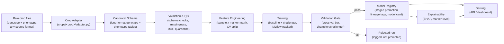

# GenoTrack — Project Specification

**Status:** Living document — source of truth for all Antigravity tasks on this project.
**Scope of this file:** the full pipeline, crop-agnostic. Crop-specific detail (e.g. the rice
HapMap ingestion adapter) lives in `crops/<crop_name>/` and must not leak into core pipeline code.

## 0. How this document should be used

This spec is the persistent context for every Antigravity task on GenoTrack, in every workspace,
regardless of which crop or dataset is currently plugged in. Keep it pinned/open alongside any
milestone-specific prompt.

Requirement language in this document follows RFC 2119: **MUST** / **MUST NOT** are hard
constraints; **SHOULD** / **SHOULD NOT** are strong defaults that need a stated reason to violate;
**MAY** is a genuine option. When a milestone-specific prompt conflicts with this spec, this spec
wins unless the person running the task explicitly overrides it in that task.

If something here is ambiguous or contradicted by what's actually in a dataset (a raw file, a
column list, a trait), **inspect the real file before writing code that assumes an answer**, and
raise the discrepancy as an Artifact rather than silently picking one interpretation.

---

## 1. Project overview

**GenoTrack** is a reproducible MLOps pipeline for genomic selection: predicting a candidate
plant's phenotypic performance (yield, resistance, quality traits) from its genetic marker data,
with full lineage from raw data to a served prediction.

The core engineering problem GenoTrack solves is **not** raw predictive accuracy — it is
**reproducibility, auditability, and portability across datasets**. A breeding program's model
informs decisions with a multi-year time horizon; a model whose lineage can't be reconstructed, or
that silently breaks the moment it's pointed at a different crop's data, is not production-usable
regardless of how accurate it is on the dataset it happened to be built on.

That second half — portability — is why this document exists. GenoTrack was first implemented
against a rice HapMap genotype/phenotype dataset, but **the crop, the raw file format, the trait
set, the population size, and even the ploidy are all expected to change** as new datasets are
plugged in. Nothing in the core pipeline may assume rice, HapMap, diploidy, or any specific trait
name. Section 5 defines exactly how that portability is enforced.

## 2. Scope & non-goals

**In scope:**
- Ingesting a crop's raw genotype + phenotype files into a canonical, crop-agnostic internal schema.
- Schema/quality validation with a full audit trail of what was rejected and why.
- Feature engineering into a model-ready sample-by-marker matrix.
- Baseline (classical genomic-selection) and challenger (gradient-boosted) modeling, tracked.
- An automated, evidence-based validation gate before any model is trusted.
- A model registry with staged promotion and lineage tags.
- Explainability surfaced in domain terms (marker/chromosome/position, not feature indices).
- A minimal serving layer (API or dashboard) for querying a promoted model.
- CI/CD: code correctness, data-contract enforcement, and a re-runnable training job.

**Out of scope for now (see Section 13 for reasoning):**
- Infrastructure-as-code / multi-environment cloud provisioning.
- Enterprise identity/RBAC — a lightweight CI approval gate stands in for this.
- Real-time/streaming ingestion — all data arrives in discrete batches (a season, a trial, a
  dataset drop), so the pipeline is batch-oriented throughout.
- Genotype imputation research (statistical imputation methods beyond a simple, swappable
  default) — GenoTrack consumes already-called genotypes, it does not call variants from raw reads.

## 3. Guiding principles

1. **Canonical schema first.** Every pipeline stage after ingestion operates only on the canonical
   genotype/phenotype schema (Section 5.1–5.2). Nothing downstream of ingestion may reference a
   raw-format-specific column name, encoding, or file layout.
2. **Config, not code, for anything that varies by dataset.** Thresholds, trait choices, ploidy,
   CV strategy, and model choice are read from `crops/<crop_name>/config.yaml` (Section 6), never
   hardcoded in pipeline modules.
3. **Nothing is silently dropped.** Any row, cell, sample, or marker excluded at any stage MUST be
   logged with a reason and, where feasible, written to a quarantine artifact — not just removed.
4. **Every run is reproducible from its lineage tags alone.** Data version hash + code commit +
   config file + resulting metrics must be sufficient to exactly reconstruct a run.
5. **A model is not "good," it is "gated."** No model reaches a state that can inform a real
   decision without passing the automated validation gate (Section 6.5) and, in CI, a human
   approval step (Section 6.9).

## 4. System architecture



Six layers, each producing a versioned artifact consumed by the next:

| Layer | Responsibility | Crop-specific? |
|---|---|---|
| Crop Adapter | Parse a crop's raw files into the canonical schema | **Yes — the only crop-specific layer** |
| Validation & QC | Enforce schema, filter on missingness/MAF, quarantine anomalies | No — thresholds come from config, logic is generic |
| Feature Engineering | Build the sample × marker matrix, define CV splits | No — encoding formula is ploidy-parameterized, not crop-specific |
| Training | Fit baseline + challenger models, track everything | No — trait(s) trained on come from the Trait Registry |
| Validation Gate | Automated pass/fail before promotion | No |
| Registry & Serving | Staged promotion, explainability, serving | No |

## 5. Data & crop abstraction layer

This section is the answer to "the dataset may change for different crops, and the features may
change too." Everything below is designed so that plugging in a new crop means writing **one new
adapter module and one new config file** — nothing else in the repository changes.

### 5.1 Canonical genotype schema (long format)

Every crop adapter MUST emit a genotype table with exactly these columns, regardless of the raw
source format (HapMap, VCF, PLINK `.bed/.bim/.fam`, a lab's custom CSV export, etc.):

| Column | Type | Notes |
|---|---|---|
| `marker_id` | string | Unique per marker. Use the source's native ID if it has one (e.g. HapMap `rs#`); otherwise synthesize `"{chrom}:{pos}"` and record that it was synthesized. |
| `chrom` | string | Chromosome / linkage group / scaffold identifier. Kept as string — not every crop's chromosome naming is numeric. |
| `pos` | integer | Physical (or genetic map) position. |
| `ref_allele` | string | Reference/major allele. |
| `alt_allele` | string, nullable | Alternate allele. **Null/flagged, not silently dropped, if the source marker is multi-allelic** — biallelic assumptions must be explicit, never implicit. |
| `ploidy` | integer | Ploidy of this crop/dataset (2 for rice, maize; 6 for hexaploid wheat; etc.). Comes from crop config, stored per-row for audit. |
| `sample_id` | string | Accession/individual identifier. Must be in the same ID space as the phenotype table's `sample_id`. |
| `batch` | string, nullable | Genotyping batch/plate, if the raw data encodes one (e.g. an ID prefix). Null if not applicable to this crop's data. |
| `call` | string | The raw allele call as given by the source, before numeric encoding (e.g. `"T"`, `"AG"`, `"N"`, `"NA"`). |
| `dosage` | float, nullable | Numeric encoding of `call`, computed in Feature Engineering (Section 6.3), on a `0..ploidy` scale. `NaN` if missing or quarantined. Not populated by the adapter — the adapter's job stops at `call`. |
| `source_format` | string | Literal name of the raw format this row was parsed from (e.g. `"hapmap"`, `"vcf"`, `"plink"`), for audit trail. |

### 5.2 Canonical phenotype schema (long format)

| Column | Type | Notes |
|---|---|---|
| `sample_id` | string | Must match the genotype table's `sample_id` space. |
| `trait` | string | Must be a key present in this dataset's Trait Registry (5.3). Pipeline code MUST NOT hardcode trait names. |
| `value` | float | Measured value. |
| `environment` | string, nullable | Trial site/location, if the dataset has multi-environment data. Null for single-environment datasets — **do not fabricate a value**. |
| `season_or_year` | string, nullable | Season/year of the trial, if present. |
| `replicate` | string, nullable | Replicate/plot identifier, if present. |
| `covariates` | string / dict, nullable | Optional trial-level covariates (e.g. JSON/dict of `{"missing_hill": 0, "moisture_content": 10.2}`). Must not be silently dropped. |

**G×E modeling is conditional on data, not assumed.** If `environment` is populated with more than
one distinct value for a trait, the modeling stage (6.4) SHOULD use the hierarchical
shared-genetic-effect-plus-environment-head architecture. If a dataset is single-environment (as
the first rice implementation is, pending confirmation — see Section 13), the pipeline MUST fall
back to a plain per-trait regression validated by population-structure-aware cross-validation, and
MUST NOT fabricate an environment split that doesn't exist in the source data.

### 5.3 Trait Registry (per-dataset config)

A YAML file, `crops/<crop_name>/traits.yaml`, is the single source of truth for what traits exist
in a given dataset and how to treat them. Pipeline code MUST read this file rather than assuming
trait names or count. Minimum required fields per trait:

```yaml
traits:
  grain_yield:
    dtype: continuous
    unit: kg_per_ha
    direction: higher_is_better
    primary_target: true          # this is what Milestones 3-4 train/gate against by default
  days_to_heading:
    dtype: continuous
    unit: days
    direction: lower_is_better
    primary_target: false
  disease_score:
    dtype: ordinal
    unit: 1_to_9_scale
    direction: lower_is_better
    primary_target: false
```

At least one trait MUST be marked `primary_target: true`; if more than one is, the training
milestone MUST ask which to target rather than picking one silently.

### 5.4 Crop Adapter contract

Each crop lives in its own package: `crops/<crop_name>/`, containing at minimum:

```
crops/<crop_name>/
  config.yaml          # ploidy, QC thresholds, CV strategy, raw file paths — see Section 6 below
  traits.yaml            # Trait Registry, Section 5.3
  adapter.py             # implements the two functions below
  README.md              # what this dataset is, where it came from, any known quirks
```

`adapter.py` MUST implement exactly this interface — the rest of the pipeline imports only this,
never anything format-specific:

```python
def parse_genotype(raw_path: str) -> pd.DataFrame:
    """Return a DataFrame conforming exactly to the Section 5.1 canonical genotype schema."""

def parse_phenotype(raw_path: str) -> pd.DataFrame:
    """Return a DataFrame conforming exactly to the Section 5.2 canonical phenotype schema."""
```

The **rice HapMap adapter** (`crops/rice/adapter.py`) is the reference implementation and the
first one to build. It parses the 11-column HapMap header
(`rs#, alleles, chrom, pos, strand, assembly#, center, protLSID, assayLSID, panelLSID, QCcode`)
plus per-accession sample columns, derives `batch` from the sample ID's letter prefix (`A`/`B`/`M`
in the current file), and MUST exclude any column that is a plate control (e.g. `BLANK`) rather
than a biological sample — this exclusion happens in the adapter, not downstream. See the
crop-specific milestone prompts for this adapter's exact build steps; this spec defines the
contract it must satisfy, not its line-by-line implementation.

### 5.5 Known cross-crop generalization risks to design around

- **Ploidy.** The `0..ploidy` dosage encoding (Section 6.3) generalizes diploid-only code (`0/1/2`)
  to any ploidy — this MUST be implemented as `ploidy`-parameterized from the start, even though
  the first dataset is diploid rice, because a hexaploid wheat dataset (see the T3/Triticeae
  Toolbox proxy dataset in the project's dataset strategy) is a plausible next crop.
- **Marker density and population size vary hugely by crop and panel.** Default QC thresholds
  (20% missingness, MAF 0.05 — see Section 6.2) are defaults in `config.yaml`, not universal
  constants. A 300-sample diversity panel and a 3,000-sample trial population warrant different
  thresholds; the pipeline MUST log whichever thresholds were actually used (already required by
  the manifest in Section 6.2) rather than assume the defaults are always correct.
- **Trait sets are not just different names — different types.** A continuous yield trait and an
  ordinal 1–9 disease score need different modeling treatment. The Trait Registry's `dtype` field
  exists specifically so training code branches on declared type, not on inference from the data.
- **Multi-allelic sites, indels, and structural variants** may appear in some crops' raw data even
  if the first rice dataset is clean biallelic SNPs. The adapter contract (5.1) requires these be
  flagged via a null/marked `alt_allele`, never silently forced into a biallelic assumption.

---

## 6. Pipeline stage specifications

Each stage below states what it does generically, and which parts are config-driven per crop.

### 6.1 Ingestion (crop-specific adapter → canonical schema)
- Input: whatever raw files `crops/<crop_name>/config.yaml` points to.
- Output: canonical genotype + phenotype tables (Sections 5.1–5.2), written to `data/interim/`.
- MUST run the Pandera schema for the canonical genotype table (call value must be derivable from
  that row's `ref_allele`/`alt_allele`, plus valid heterozygote codes, `N`, `NA`) and produce a
  validation report of every failing row — this is what catches format-corruption anomalies (e.g.
  a stray QC percentage landing in a sample column) regardless of which crop's adapter produced it.

### 6.2 Validation & QC
- Missingness filter: drop markers/samples exceeding `config.yaml`'s missingness threshold.
- MAF filter: drop markers below `config.yaml`'s MAF threshold, computed from `ref_allele`/
  `alt_allele` frequency.
- Quarantine: anything rejected by 6.1's schema check or by these filters is written to
  `data/interim/quarantined_<stage>.csv`, never just deleted.
- Batch-effect check: if `batch` is populated (nullable per 5.1), cross-tabulate it against Trait
  Registry traits and flag — do not auto-correct — apparent confounding.
- Output: `data/processed/manifest.json` recording the DVC hash of the raw inputs, the exact
  threshold values used (from config, so this is an audit record, not a re-statement of defaults),
  and row/column counts before and after each filter.

### 6.3 Feature engineering
- Transpose the cleaned long-format genotype table into a sample-by-marker `dosage` matrix, using
  the **ploidy-parameterized** encoding: dosage = count of `alt_allele` copies out of `ploidy`
  (i.e. `{0,1,2}` for diploid, `{0,...,6}` for hexaploid, etc.), computed from `call`.
- Missing dosage imputation strategy MUST be swappable (config-selectable), defaulting to
  per-marker mean dosage — never hardcoded to one method only.
- Join to phenotype table on `sample_id`, inner join, logging any IDs present in one table but not
  the other.
- CV/split strategy MUST be population-structure-aware, not a naive random split (related
  individuals inflate apparent accuracy in genomic prediction). Use a population/subgroup label
  from the phenotype table if the Trait Registry or config declares one exists; otherwise cluster
  on marker-matrix PCA and use the resulting clusters as CV groups. Whichever path is taken MUST be
  logged as part of the run's lineage, not just chosen silently.

### 6.4 Training
- Always fit a classical genomic-selection baseline (ridge / Bayesian ridge — the GBLUP-style
  comparator) alongside any ML challenger (XGBoost/LightGBM by default, config-overridable). A
  challenger is never evaluated in isolation, only against this baseline.
- If the phenotype table's `environment` column has more than one distinct value for the target
  trait (per 5.2), use the hierarchical shared-genetic-effect + environment-head architecture;
  otherwise use plain regression over the CV groups from 6.3.
- Log to MLflow: DVC data hash, config file hash, CV strategy used, hyperparameters, per-fold and
  mean metrics (minimum: Pearson correlation and RMSE against the target trait), and the trained
  model artifact, as nested runs under one parent experiment per (crop, trait) pair.

### 6.5 Validation gate
- Pass/fail decided against a named, config-defined bar: mean CV correlation must exceed the
  baseline's, and no single fold may regress beyond a configured margin below the mean.
- A second check — no regression against the current registry `Production` alias, if one exists
  for this (crop, trait) — gates promotion beyond `Staging`.
- Output is a structured pass/fail report, never a bare boolean, and MUST be demonstrated to
  actually reject a deliberately weakened model before being trusted (see CI, 6.9).

### 6.6 Model registry
- MLflow Model Registry, staged `Staging → Production`, keyed by `(crop, trait)`.
- Every registered version carries lineage tags: DVC data hash, config hash, code commit, CV
  strategy, validation-gate report.
- Auto-generates a model card (markdown) alongside the registered model summarizing all of the
  above plus the promotion decision and its reasoning — this is a reviewable artifact in CI (6.9),
  not just a log line.

### 6.7 Explainability
- SHAP (TreeExplainer for tree-based challengers) global marker importance and per-prediction
  explanation.
- MUST map explanations back to `marker_id` / `chrom` / `pos`, never raw feature-matrix indices —
  the point is legibility to a breeder, not just to whoever wrote the model.

### 6.8 Serving
- A minimal API or dashboard (FastAPI or Streamlit, config-selectable) loading the current
  `Production`-aliased model for the requested `(crop, trait)` pair.
- Accepts either a full dosage vector or an existing `sample_id` already in the processed matrix,
  returns the predicted value plus top contributing markers.
- Must be rebuildable into a container (Docker) started with a single command.

### 6.9 CI/CD
- **Code CI:** lint + unit tests for QC and feature-engineering functions, on every push.
- **Data CI:** re-run 6.1's Pandera schema against the current crop's raw genotype file; fail the
  workflow on any unexpected violation. Include a deliberately-broken-data test fixture that proves
  this job can actually fail, not just pass.
- **CT (manually triggered):** re-run 6.2–6.5 end to end, post the resulting model-card diff as a
  PR comment.
- **Governance:** promotion past `Staging` requires a GitHub Actions environment protection rule
  (a human-approved job) — this stands in for full RBAC (see Section 2, out of scope) as a real,
  working, minimally-scoped control.

---

## 7. Configuration reference

`crops/<crop_name>/config.yaml` — every field a crop adapter and pipeline run needs, with no
pipeline code allowed to hardcode any of these values:

```yaml
crop_name: rice
ploidy: 2

raw_files:
  genotype: data/raw/genotype.txt
  phenotype: data/raw/phenotype.txt
  source_format: hapmap          # hapmap | vcf | plink | csv | ...

qc:
  missingness_threshold: 0.20     # drop markers/samples above this fraction missing
  maf_threshold: 0.05             # drop markers below this minor-allele frequency
  imputation_strategy: per_marker_mean

cv:
  strategy: auto                  # auto | population_label | pca_cluster
  population_label_column: null   # set if phenotype table has one; else PCA-cluster fallback is used
  n_folds: 5

modeling:
  baseline: ridge
  challenger: xgboost             # xgboost | lightgbm
  gate:
    min_relative_improvement_over_baseline: 0.0   # challenger must at least match baseline to pass
    max_single_fold_regression: 0.05

serving:
  framework: fastapi               # fastapi | streamlit
```

---

## 8. Repository structure

```
genotrack/
  spec.md                    # this file
  crops/
    rice/
      config.yaml
      traits.yaml
      adapter.py
      README.md
    <next_crop>/               # added later, same contract, zero changes elsewhere
  data/
    raw/                        # untouched originals, DVC-tracked, per crop subfolder
    interim/                    # parsed + quarantine artifacts
    processed/                  # cleaned feature matrices + manifest.json, DVC-tracked
  src/
    ingest/                     # calls the active crop's adapter, runs schema validation
    clean/                      # generic QC filters, config-driven
    features/                   # generic feature engineering + CV split
    models/                     # baseline, challenger, gate, explain — all generic
    serve/                       # API/dashboard
  pipelines/                    # dvc.yaml stages / orchestration
  tests/
    fixtures/                   # includes a deliberately-broken-data fixture for Data CI
  .github/workflows/
  mlruns/
  README.md
```

## 9. Technology stack

| Concern | Tool | Notes |
|---|---|---|
| Data versioning | DVC | Per-crop raw + processed snapshots |
| Data validation | Pandera | Canonical-schema enforcement, crop-agnostic |
| Config | YAML (`config.yaml`, `traits.yaml`) | No pipeline code hardcodes crop-specific values |
| Modeling | scikit-learn (ridge baseline), XGBoost/LightGBM (challenger) | Challenger swappable per config |
| Tracking & registry | MLflow | Keyed by `(crop, trait)` |
| Explainability | SHAP | Mapped to marker/chrom/pos |
| Serving | FastAPI or Streamlit | Config-selectable |
| Containerization | Docker | Serving app |
| CI/CD | GitHub Actions | Code CI, Data CI, manual CT, approval-gated promotion |
| Dev environment | Google Antigravity, Planning mode for multi-file milestones | Executes milestones as reviewable Artifacts |

## 10. Non-functional requirements

- **Reproducibility:** any registered model MUST be reconstructable from its logged lineage tags
  (data hash, config hash, code commit) alone.
- **Auditability:** every exclusion (row, sample, marker, cell) MUST be traceable to a logged
  reason, per Guiding Principle 3.
- **Portability:** adding a new crop MUST require only a new `crops/<crop_name>/` package — zero
  changes to `src/`.
- **Data sensitivity:** breeding genotype/phenotype data may be commercially sensitive. Raw data
  files and DVC remotes MUST NOT be pushed to a public remote by default; treat this as private
  data unless a crop's `README.md` states otherwise.

## 11. Testing & verification strategy

- Unit tests for every QC filter and the dosage-encoding function, parameterized across at least
  two ploidy values (2 and 6) to prove the ploidy-generalization claim in Section 6.3 isn't just
  aspirational.
- A fixture dataset containing at least one deliberately malformed genotype cell (mirroring the
  real anomaly found in the rice data) to prove the Data CI job fails when it should.
- An integration test that runs a full adapter → QC → feature → baseline-model pass on a tiny
  synthetic crop fixture, so the "add a new crop" path is actually exercised in CI, not just
  described in this document.

## 12. Roadmap

The first implementation targets the rice crop pack. Detailed, sequenced Antigravity task prompts
for that build (repo scaffold → ingestion → QC/versioning → features/baseline/tracking →
validation gate/registry → explainability/serving → containerization/CI) live in a separate
milestone-prompt document and should be run as described there, with this spec pinned as shared
context. Future crop packs follow the same six-milestone shape, but Milestone 1 becomes "write
`crops/<new_crop>/adapter.py` against the Section 5 contract" instead of a from-scratch parser.

## 13. Open questions & assumptions to confirm before relying on this spec

- **Phenotype schema is unconfirmed.** No phenotype file has been inspected yet as of this
  writing — Section 5.2's columns are the canonical *target* shape, not a confirmed description of
  any real file. The first ingestion task MUST open and preview the actual phenotype file before
  any trait-name assumption is baked into code.
- **Multi-environment data is unconfirmed for the rice dataset.** Section 5.2's G×E conditionality
  assumes this will be discovered from the data, not asserted here.
- **Population-structure label availability is unconfirmed.** Section 6.3's CV strategy therefore
  defaults to `auto` (PCA-cluster fallback) in the config template until a real population label
  column is confirmed to exist.

---

## Appendix A — Glossary

| Term | Meaning |
|---|---|
| Genotype | An individual's genetic marker data (which allele(s) it carries at each SNP). |
| Phenotype | An individual's measured trait(s) (yield, height, disease score, etc.). |
| Genomic selection | Predicting phenotype from genotype directly, without a full field trial. |
| SNP | Single nucleotide polymorphism — a single-position genetic marker. |
| Allele | One of the possible DNA sequence variants at a marker position. |
| MAF | Minor allele frequency — how common the less-frequent allele is at a marker; low-MAF markers carry little statistical signal. |
| Dosage | Numeric encoding of a genotype call as a count of the alternate allele, `0..ploidy`. |
| Ploidy | Number of chromosome copies an organism carries (2 = diploid, 6 = hexaploid, etc.). |
| G×E | Genotype-by-environment interaction — the same genotype performing differently across environments. |
| GBLUP | Genomic Best Linear Unbiased Prediction — the classical linear genomic-selection method GenoTrack's ridge baseline approximates. |
| HapMap format | A common plant-genomics text format: marker metadata columns followed by one genotype-call column per sample. |
| Population structure | Non-random genetic relatedness/clustering among samples (e.g. subpopulations), which inflates apparent model accuracy if ignored in cross-validation. |

## Appendix B — Canonical schema quick reference

```
Genotype (long): marker_id, chrom, pos, ref_allele, alt_allele, ploidy, sample_id, batch, call, dosage, source_format
Phenotype (long): sample_id, trait, value, environment, season_or_year, replicate, covariates
```
